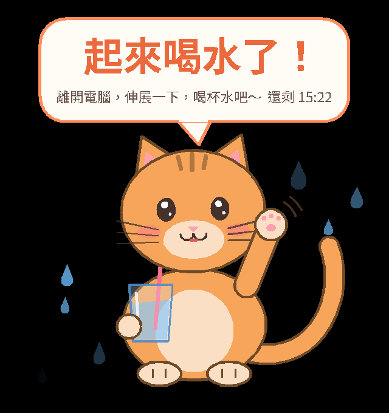

# CatSaver 🐱💧

A cute Windows hydration reminder. CatSaver runs quietly in the system tray. At the top of every hour an animated cat pops up in the middle of the screen, holding a glass of water and waving, and says **「起來喝水了！」**. It stays for **10 minutes** (adjustable), then fades away on its own. This repeats every hour.



> Why not a real `.scr` screen saver? Windows only starts screen savers when the PC is idle, so one can't reliably pop up on the hour while you're working. CatSaver is a tray app that draws an always-on-top overlay instead.

## Features

- Background tray app; launching it shows no window.
- Reminders start at every exact hour (10:00, 11:00, ...), last 10 minutes, then hide automatically.
- Animated cats from [Google's Noto animated emoji](https://googlefonts.github.io/noto-emoji-animation/). By default each reminder picks a different set:
  - 😺 **開心貓**: 😺 → 😸 → 😻 → 😽
  - 🙀 **戲精貓（催你喝水）**: 🙀 → 😿 → 😾 → 😹
  - 😼 **傲嬌貓**: 😼 → 🐱 → 😹
  - 🦁 **大貓**: 🦁 roaring lion → 🐅 stretching tiger
  - 🐈 **真貓橘子（走過來陪你）**: a real-looking orange tabby (AI-generated video) walks in across the whole screen and sits down under the bubble, sometimes with a big stretch first. It looks around, then meows, waves, tilts its head or drinks from a bowl. Then it gets up and walks off, and comes back from the other side

  A drink (🧋 bubble tea, 🍵 tea or 💧 a water drop) bobs next to the cat. The cat arrives in one of three ways: pops up, drops in with a bounce, or peeks up from below. Water drops and hearts float around it, and the speech bubble shows the message and a countdown (「還剩 15:42」). You can pick a fixed set, or the hand-drawn cat that waves and holds a glass of water, under 設定 → 貓咪樣式.
- Dims every monitor and shows the cat on each one (configurable to the primary monitor only).
- **「我喝了！」 button** under the cat. It records a cup of water, and the cat celebrates (「好棒！今天第 3 杯水」) but **stays** until the time is up, so you still take your break. The button then shows 「已記錄第 3 杯」, so a cup can't be counted twice. Today's count is shown in the tray menu and tooltip, and is stored in `water.json`.
- **「我在忙，先關掉」 button**: the only way to close the cat early. It appears **30 seconds** after the cat (adjustable, minimum 30), so the reminder can't be clicked away by reflex. Neither button takes focus from the app you're typing in.
- **Click the cat**: it jumps, gets heart eyes 😻 and bursts hearts. Only the cat itself is clickable; the rest of the overlay still lets clicks through.
- **Postpones during presentations and full-screen apps** (PowerPoint slide show, full-screen video, games). The reminder shows once you're done, for the full duration.
- **Settings window** (double-click the tray icon, or tray → 設定…). While it is open, the cat is previewed live and follows every change. The preview doesn't dim the screen, has no buttons, and clicks pass through. Closing the window ends the preview. 儲存 applies immediately, no restart. 換一隻貓 picks another random cat.
- **Doesn't steal focus.** The overlay never takes keyboard focus, and by default mouse clicks pass through to the apps underneath.
- Starts with Windows (installer checkbox, or toggle in the tray menu).
- Tray menu (right-click the cat icon):
  - status line: next reminder / paused until / waiting for your presentation, plus today's cups of water
  - 現在顯示貓咪: show the cat now
  - 關閉這次提醒: dismiss the current reminder
  - 我喝了一杯水（+1）: record a cup without waiting for the cat
  - 暫停提醒 ▸ 1 小時 / 2 小時 / 今天都不要提醒 (resumes on its own), and 恢復提醒
  - 開機時自動啟動: start with Windows
  - 設定…: open the settings window (also: double-click the icon, or launch CatSaver.exe again)
  - 重新啟動: restart
  - 結束: quit
- If the PC wakes up or the app starts partway through a reminder window (say 10:05), the cat shows for the rest of that window (until 10:10).

## Install (end users)

Download from the GitHub Actions build artifacts or a GitHub Release. Either:

- **`CatSaver-Setup.exe`** (recommended): a per-user install with no admin rights needed. It offers "開機時自動啟動" (checked by default) and launches CatSaver when it finishes.
- **`CatSaver.exe`**: a portable, self-contained single exe that doesn't need the .NET runtime. Put it anywhere and run it. To start it with Windows, right-click the tray icon and choose 「開機時自動啟動」.

Windows SmartScreen may warn the first time because the exe isn't code-signed. Click *More info → Run anyway*.

To check the look without waiting for the next hour, choose tray → 現在顯示貓咪 (or 設定… → 預覽), or run `CatSaver.exe --show`. `CatSaver.exe --settings` opens the settings window on start.

## Configuration

Use the settings window for normal changes. Everything is stored in `%APPDATA%\CatSaver\config.json` (created with defaults on first run). The settings window has a link to that folder. If you edit the file by hand, choose tray → 重新啟動 afterwards. Errors are logged to `error.log` in the same folder (rotated at 512 KB). If the exe is moved, the start-with-Windows entry is updated to the new path on the next launch.

```json
{
  "intervalMinutes": 60,          // minutes between reminders, aligned to midnight (60 = every exact hour)
  "durationMinutes": 10,          // how long the cat stays
  "message": "起來喝水了！",
  "subMessage": "離開電腦，伸展一下，喝杯水吧～",
  "showCountdown": true,
  "postponeWhenBusy": true,       // wait while presenting / full-screen
  "showDrinkButton": true,        // 「我喝了！」 button (counts cups)
  "drinkButtonText": "我喝了！",
  "showDismissButton": true,      // 「我在忙，先關掉」 button under the cat
  "dismissButtonDelaySeconds": 30, // the dismiss button appears after this many seconds (min 30)
  "dismissButtonText": "我在忙，先關掉",
  "monitors": "all",              // "all" or "primary"
  "dimScreen": true,
  "dimOpacity": 0.35,             // 0.0 – 0.9
  "clickThrough": true,           // false = dimmed area blocks mouse clicks (keyboard is never blocked)
  "catScale": 1.0,                // 0.2 – 2.0
  "animation": "random",          // "random", "happy", "drama", "cool", "bigcat", "realcat" or "classic" (hand-drawn)
  "catColor": "#F6A55A",          // fur colour of the hand-drawn cat
  "animationFps": 30,
  "fontFamily": "Microsoft JhengHei UI"
}
```

Comments are allowed in the file. Out-of-range values are clamped to safe limits. If the file is broken, CatSaver falls back to the defaults and shows a warning balloon.

## Build from source

Requirements: Windows 10/11 and the [.NET 8 SDK](https://dotnet.microsoft.com/download/dotnet/8.0). For the installer you also need [Inno Setup 6](https://jrsoftware.org/isinfo.php) (`winget install JRSoftware.InnoSetup`).

```powershell
# run from the repo root
.\build.ps1                 # -> artifacts\publish\CatSaver.exe (self-contained single file)
.\build.ps1 -Test -Installer  # also run unit tests and build artifacts\CatSaver-Setup.exe

# or, while developing
dotnet run --project src\CatSaver -- --show
dotnet test tests\CatSaver.Tests
```

CI (`.github/workflows/build.yml`) builds both files on `windows-latest` for every push and PR and uploads them as the **CatSaver** artifact. Pushing a `v*` tag (e.g. `v1.0.0`) also attaches them to a GitHub Release.

## Code layout

```
src/CatSaver/
  Program.cs              entry point, single-instance mutex, restart handling
  TrayApplication.cs      tray icon + menu, 1-second schedule check → show/hide overlay, live config apply
  SettingsForm.cs         settings window
  ReminderSchedule.cs     pure scheduling logic (interval / duration), unit-tested
  ReminderState.cs        show / dismiss / pause / postpone-while-busy decisions, unit-tested
  UserActivity.cs         "is the user presenting / full-screen?" (SHQueryUserNotificationState)
  WaterLog.cs             cups of water per day (water.json)
  Log.cs                  error.log with rotation
  AppConfig.cs            JSON config with defaults + validation
  AutoStart.cs            HKCU\...\Run registry entry
  NativeMethods.cs        Win32 interop
  Overlay/
    OverlayManager.cs     creates the windows per monitor, animation loop, fade in/out, keeps topmost
    LayeredWindow.cs      base per-pixel-alpha window (UpdateLayeredWindow), topmost, no-activate
    CatWindow.cs          the cat (click-through)
    PillButton.cs         「我喝了！」/「我在忙，先關掉」 buttons (clickable, still no focus steal)
    CatHitArea.cs         invisible click target over the cat (for the jump + hearts)
    DimForm.cs            semi-transparent full-screen dimming layer
    CatRenderer.cs        draws the cat, drops/hearts and speech bubble with GDI+ (change the look here)
    SpriteCatalog.cs      the embedded Noto sprite sheets, cat sets and drink props (sprites.json)
    SpritePlayer.cs       plays a list of sprite sheets (ping-pong and mirroring supported)
    RealCatScene.cs       the real cat's routine: walk in, sit down, act, stand up, walk off
  Assets/Noto/            Noto cat sprite sheets + sprites.json (regenerate with tools/make_noto_sprites.py)
  Assets/RealCats/        background-removed real cat clips + realcats.json (tools/make_real_cats.py)
  Assets/catsaver.ico     app/tray icon (also generated by tools/make_noto_sprites.py)
tests/CatSaver.Tests      xUnit tests for the schedule and reminder state (runs on any OS)
installer/CatSaver.iss    Inno Setup script
```

To add a cat set or a drink, edit `SPRITES` / `SETS` / `PROPS` in `tools/make_noto_sprites.py` and run it. New sets appear in the settings window automatically. Codepoints are listed at https://googlefonts.github.io/noto-emoji-animation/. To change the hand-drawn cat or the bubble, edit `Overlay/CatRenderer.cs`. Everything is drawn in an 800×880 logical canvas that is scaled to the screen, and the `Draw` method gets the elapsed time and remaining time for each frame.

## Credits

The real cat (橘子) comes from AI-generated green-screen videos made by the project owner. They were background-removed, cropped and packed into sprite sheets with `tools/make_real_cats.py`; the source videos are not in the repo. The tool can also fetch green-screen clips from [Pixabay](https://pixabay.com/) through its API.

To add your own cats (e.g. generated videos), see [docs/cat-video-brief.md](docs/cat-video-brief.md) and `tools/make_real_cats.py`.

The cat, lion, tiger and drink animations and the app icon use [Noto Emoji Animation](https://googlefonts.github.io/noto-emoji-animation/) by Google, licensed under [CC BY 4.0](https://creativecommons.org/licenses/by/4.0/). The frames were resized and converted to PNG sprite sheets.

## License

CatSaver is open source under the [MIT License](LICENSE). This covers the code, the hand-drawn cat, and the real cat 橘子 sprites made from the project owner's AI-generated videos. The Noto emoji sprites and the app icon are © Google, under [CC BY 4.0](https://creativecommons.org/licenses/by/4.0/).

## Code signing policy

Free code signing provided by [SignPath.io](https://signpath.io), certificate by [SignPath Foundation](https://signpath.org).

- Only release builds (`v*` tags) are signed. They are built and signed automatically by GitHub Actions from the source in this repository (`.github/workflows/build.yml`).
- Committers and reviewers: [htylab](https://github.com/htylab)
- Approvers: [htylab](https://github.com/htylab)

## Privacy

This program will not transfer any information to other networked systems unless specifically requested by the user or the person installing or operating it. Settings, the error log and the daily water count stay on your computer in `%APPDATA%\CatSaver`.
